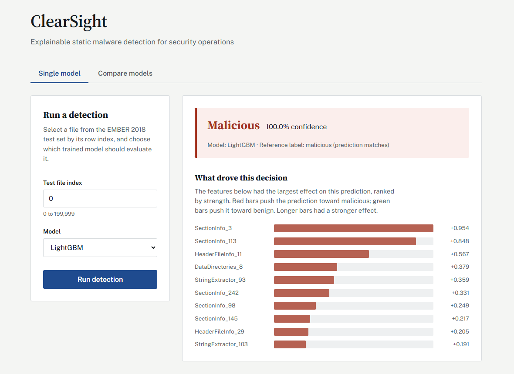
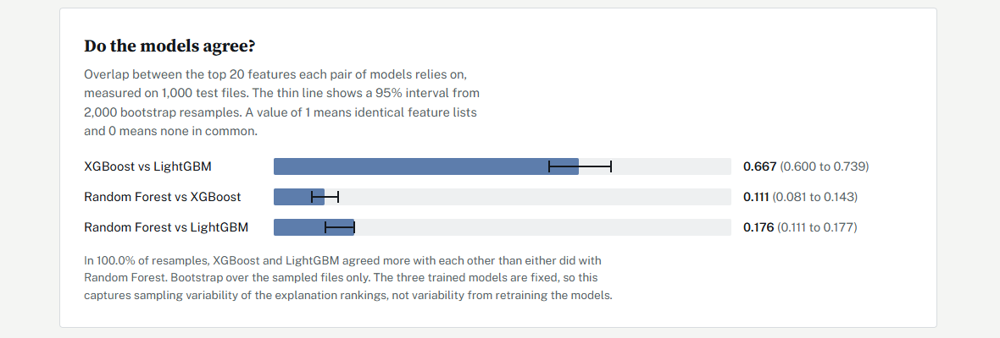
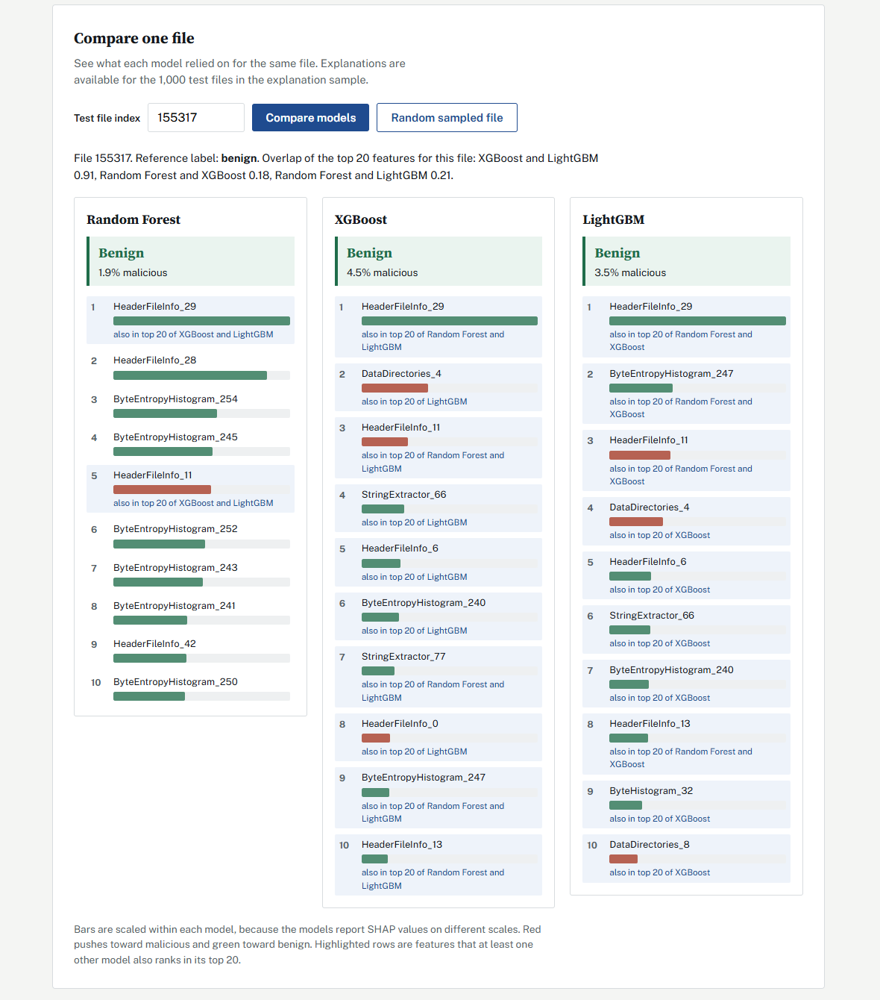
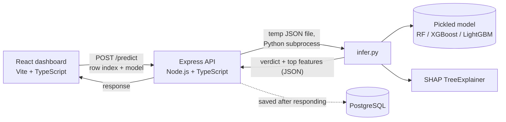

# ClearSight

**Explainable static malware detection for security analysts.**

ClearSight classifies a Windows executable as *malicious* or *benign* and, on the same screen, shows **which features of the file pushed the model towards that verdict**. A second view compares what three different models relied on for the same file.

It is a full-stack proof of concept: trained machine-learning models in Python, a TypeScript API, a PostgreSQL audit trail, and a React dashboard.



## Why it exists

A detector that only returns a score gives an analyst nothing to check. When a file is flagged, the analyst needs to know *why*, both to investigate false positives and to justify a decision to someone else.

Explanation methods such as SHAP can answer that, but in most research code they stay a separate chart made after evaluation. ClearSight puts the explanation **inside the detection workflow**, so it arrives together with the verdict. It also asks a second question: when different models agree that a file is malicious, do they agree for the *same reasons*?

## What it does

- **Verdict with confidence.** Pick a file from the EMBER 2018 test set (row 0 to 199,999) and one of three trained models. ClearSight returns malicious or benign, the model's confidence, and whether the prediction matches the dataset's reference label.
- **Ranked explanation.** The ten most influential features appear as horizontal bars. Red pushes towards malicious, green towards benign, and the SHAP value is printed beside each bar, so meaning never depends on colour alone.
- **Three interchangeable models.** Random Forest, XGBoost and LightGBM.
- **Do the models agree?** Measures the overlap between each pair of models' top-20 features over 1,000 test files, with a 95% interval from 2,000 bootstrap resamples.
- **Compare one file.** Shows the three models' explanations side by side and highlights features that at least one other model also ranks in its top 20.
- **Audit trail.** Every prediction is saved to PostgreSQL, with its top features stored as JSONB.



## Results

Measured on 200,000 held-out files from EMBER 2018 (600,000 files were used for training):

| | LightGBM | XGBoost | Random Forest (depth 20) |
|---|---|---|---|
| Accuracy | **96.73%** | 95.60% | 94.36% |

- LightGBM reached an **AUC-ROC of 0.994** and trained in **8.8 minutes**.
- **Capping Random Forest depth at 20** cut its training time from 86.4 to 45.2 minutes and cost under one percentage point of accuracy (95.34% to 94.36%). That made exact SHAP values feasible for it.
- **The models differ in what they rely on, not only in how accurate they are.** XGBoost and LightGBM share 16 of their top 20 features (Jaccard overlap 0.667, 95% interval 0.600 to 0.739). Random Forest overlaps far less with either, leaning heavily on byte-entropy features.



## How it works



1. The dashboard sends a row number and a model name to the API.
2. The API writes the request to a temporary JSON file and starts `infer.py` as a Python subprocess.
3. `infer.py` loads the pickled model, predicts, computes SHAP values for that one file, and prints the result as JSON.
4. The API returns that JSON to the page and saves it to PostgreSQL **after** responding, so a database failure cannot break a prediction.

### Design decisions

- **Python stays Python.** The models are trained and tested in Python, so the API calls the same code through a subprocess instead of re-implementing it in TypeScript. Node handles routing, validation and storage.
- **Explanations are computed per request**, for the one file being viewed, using SHAP's `TreeExplainer` on tree models.
- **Honest uncertainty.** The agreement view reports confidence intervals from bootstrapping over the sampled files, not a single number.
- **Colour is never the only signal.** Every bar carries its signed SHAP value as text.

## Tech stack

| Layer | Technology |
|---|---|
| Machine learning | Python 3.14, scikit-learn (Random Forest), XGBoost, LightGBM |
| Explainability | SHAP (`TreeExplainer`) |
| Data | EMBER 2018: 600,000 training and 200,000 test files, 2,381 numeric features per file |
| Backend | Node.js, Express 4, TypeScript, `pg`, `dotenv`, `cors` (port 3001) |
| Database | PostgreSQL |
| Frontend | React 18, TypeScript, Vite 5, plain CSS (no UI library) |

## API

| Endpoint | Purpose |
|---|---|
| `POST /predict` | Predict and explain one file with a chosen model |
| `GET /history` | Past predictions stored in PostgreSQL |
| `GET /health` | Liveness check |

Two further endpoints, `/agreement` and `/compare`, serve the Compare models tab.

## Repository layout

```
clearsight-backend/    Express + TypeScript API (calls infer.py, writes to PostgreSQL)
clearsight-frontend/   React + Vite dashboard
notebooks/             Training, SHAP and comparison scripts, plus the EDA notebook
results/               Output of the agreement analysis
get_ember.py,
download_ember_fixed.py  Download helpers for the EMBER dataset
```

The EMBER dataset and the trained models are **not** in this repository because of their size (several gigabytes).

## Running it locally

You need Python 3.14, Node.js, and PostgreSQL.

1. **Get the data.** Download EMBER 2018 from its original source with `get_ember.py`, and follow its licence terms.
2. **Train the models.** Run the scripts in `notebooks/`: `train_lightgbm.py`, `train_xgboost.py` and `train_random_forest_v2.py`, then `compute_shap*.py`, `build_comparison_data.py` and `bootstrap_agreement.py` for the explanation analysis.
3. **Start the backend.** In `clearsight-backend/`, run `npm install` then `npm run dev`. The API listens on port 3001. Database settings are read from environment variables (see `src/db.ts`).
4. **Start the dashboard.** In `clearsight-frontend/`, run `npm install` then `npm run dev`, and open http://localhost:5173.

## Limitations

- It is a **proof of concept**: it runs locally and has no login.
- It works from **pre-extracted EMBER feature vectors**, so it cannot yet take an uploaded executable.
- SHAP explains **what the model used**, not whether a file is truly malicious. The output is decision support, not proof.
- It shows that an explained detection workflow is feasible. It does **not** show that analysts work faster with it, which would need a user study.

**Next steps:** extract features from an uploaded file, run a study with analysts, and repeat the model comparison across several training runs.

## References

- H. S. Anderson and P. Roth. *EMBER: An Open Dataset for Training Static PE Malware Machine Learning Models.* 2018.
- S. M. Lundberg and S.-I. Lee. *A Unified Approach to Interpreting Model Predictions.* NeurIPS 2017. (SHAP)
- G. Ke et al. *LightGBM: A Highly Efficient Gradient Boosting Decision Tree.* NeurIPS 2017.
- T. Chen and C. Guestrin. *XGBoost: A Scalable Tree Boosting System.* KDD 2016.

## Author

**John Esonu**, Computer Science, Pan-Atlantic University, Lagos. I build backend systems and AI automation, and I like showing the evidence behind a result.

- Portfolio: https://portfolio-seven-red-60o1w6yc1i.vercel.app
- LinkedIn: https://linkedin.com/in/johnesonu-213970291
- GitHub: https://github.com/Esjen
